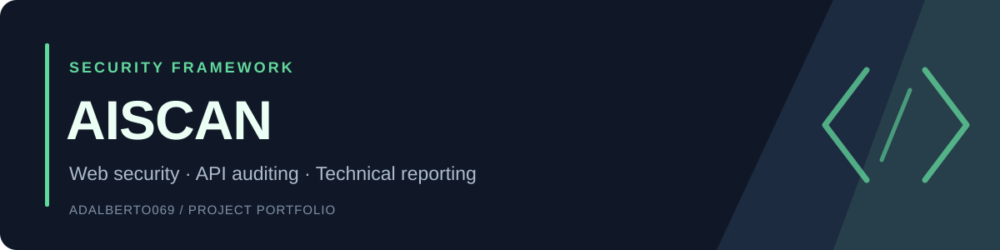

# AIScan

Framework de auditoria de segurança especializado em aplicações web criadas por IA (Lovable, Bolt e v0).

**Python + Lua | Beta**

## Instalação

Requisitos: Git e Python 3.12.

### Linux / Kali Linux / macOS

```bash
git clone https://github.com/Adalberto069/Aiscan.git
cd Aiscan
python3 -m venv .venv
source .venv/bin/activate
pip install -r requirements.txt
```

### Windows (PowerShell)

```powershell
git clone https://github.com/Adalberto069/Aiscan.git
cd Aiscan
python -m pip install -r requirements.txt
```

## Uso

```bash
python aiscan.py --help
python aiscan.py --list-modules
python aiscan.py --source .
python aiscan.py --graph lab/architecture.json
python aiscan.py -u https://example.com --only recon --redact
python aiscan.py -u https://example.com --module headers_audit.lua --redact
```

## Opções

| Flag | Descrição |
| --- | --- |
| `-u, --url` | Alvo autorizado |
| `--module` | Módulo específico |
| `--list-modules` | Lista módulos |
| `--source` | Inventário de código local |
| `--graph` | Análise de modelo de arquitetura |
| `--redact` | Reduz exposição de dados |
| `--html` | Relatório HTML |
| `--json` | Relatório JSON |
| `--sarif` | Relatório SARIF |

## Revisão de migrações PostgreSQL

```bash
python -m core.rls_review lab/rls_review.sql
```

Analisa um arquivo SQL local (até 1 MiB), apontando a última instrução explícita reconhecida de desativação de RLS por tabela. Não executa SQL, não acessa banco de dados e não prova exposição no ambiente publicado. SQL dinâmico, permissões, transações, outras migrações e resolução de nomes não são analisados. Ausência de alertas não significa segurança.

## Testes

```bash
python -m unittest discover -s tests -v
```

[Arquitetura](docs/ARCHITECTURE.md) · [Laboratório](lab/README.md) · [SGE](docs/SGE.md)

Use somente em sistemas próprios ou autorizados. A opção `--redact` não garante anonimização completa; revise os resultados antes de compartilhar.
