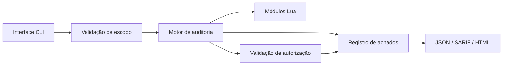

# Arquitetura técnica

- [aiscan.py](../aiscan.py): interface de linha de comando e orquestração.
- [core](../core): escopo, verificações, integração Lua e resultados.
- [modules](../modules): verificações modulares.
- [lab](../lab): laboratório controlado.
- [tests](../tests): testes de escopo, autorização e resultados.

## Qualidade

Consulte o [laboratório](../lab/README.md) para os cenários de validação local. Revise falsos positivos, evidências e cobertura antes de utilizar resultados em decisões de segurança.

O projeto é beta. Use exclusivamente em sistemas próprios ou expressamente autorizados. A arquitetura não representa certificação de segurança nem resultados de testes executados.
